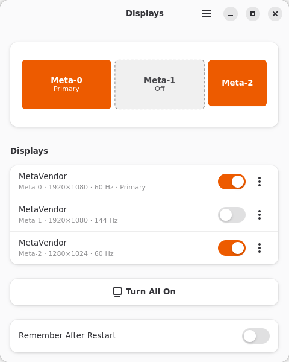
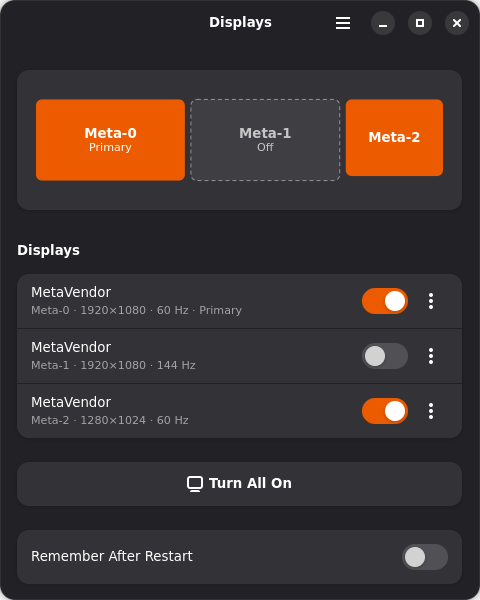

# gnome-monitor-toggle

Turn individual displays on and off under GNOME on Wayland, similar to Windows'
"Show only on 1" option. Ships a GTK 4/libadwaita app (`monitor-ui`) and a command-line tool
(`monitor`).

<p align="center">
  
  
</p>

## Why

- `xrandr` cannot disable outputs on Wayland (it fails with `BadMatch`).
- GNOME Settings → Displays has no switch to turn off a single display.
- This tool uses GNOME's own D-Bus API (`org.gnome.Mutter.DisplayConfig`), so the display is
  really turned off and GNOME keeps working normally.

## Requirements

- Python 3 with PyGObject (`python3-gi`)
- The app: GNOME 47 or newer (GTK 4.14+, libadwaita 1.6+); tested on GNOME 50 / Ubuntu 26.04
- The `monitor` command: GNOME 45 or newer

On older systems `install.sh` installs only the `monitor` command and says why.

```bash
sudo apt install python3-gi gir1.2-gtk-4.0 gir1.2-adw-1
```

## Install

```bash
git clone https://github.com/anilsoylu/gnome-monitor-toggle.git
cd gnome-monitor-toggle
./install.sh              # CLI + app
./install.sh --desktop    # also put a launcher on the desktop
```

Files go to `~/.local/bin`, the launcher to `~/.local/share/applications` and translations to
`~/.local/share/locale`. Remove everything with `./uninstall.sh`.

## The app

Open **Monitor Toggle** from Activities, or run `monitor-ui`.

- The preview shows every connected display at its position; displays that are off are drawn
  with a dashed outline.
- Use the switch on a row to turn that display on or off. A toast offers **Undo**.
- **Use Only This Display** (row menu) turns every other display off.
- **Turn All On** brings back every connected display.
- **Remember After Restart** keeps changes after logging out (see below). The setting itself is
  remembered between launches.
- The list updates by itself when a display is plugged in or changed in GNOME Settings.
  <kbd>Ctrl</kbd>+<kbd>R</kbd> refreshes manually.

The interface follows the system language; a Turkish translation is included.

## Command line

```bash
monitor list                  # connected displays and their state
monitor off DP-1              # turn a display off
monitor on DP-1               # turn it back on
monitor only DP-1             # keep only DP-1 on
monitor on                    # turn every display on
monitor off DP-1 --persist    # keep the change after logging out
```

```
Connected displays:
  * DP-1     DEL AW2521HFLA       on   1920x1080@240Hz (primary)
    DP-2     ACI VG248            off  1920x1080@144Hz
```

Connector names (`DP-1`, `HDMI-A-1`, …) come from `monitor list`.

## How it works

`monitorctl.py` holds the shared logic:

- `GetCurrentState` reads the current layout.
- Before a change, the full layout of every display is saved to
  `~/.local/state/monitor-toggle/state.json`, so a display comes back at the same position, scale
  and refresh rate (a 240 Hz panel does not drop to 60 Hz).
- `ApplyMonitorsConfig` applies the new layout. Gaps left by a display that was turned off are
  closed and exactly one display stays primary, which Mutter requires.

Changes are **temporary** by default: after logging out GNOME goes back to its saved
`monitors.xml`. With `--persist` or **Remember After Restart**, GNOME shows its
"Keep these display settings?" dialog. Choose **Keep Changes** within 20 seconds, or GNOME
reverts the change.

## Known limitations

- Mirrored outputs (one logical display shown on several outputs) are not supported.
- Layouts where displays only touch at a corner after another display is turned off are
  rejected by GNOME.
- At least one display always stays on.

## Development

Tests run against a real headless Mutter with virtual monitors inside Docker, so they never touch
your desktop:

```bash
tests/run-in-docker.sh python3 -m unittest discover -s tests -v
tests/run-in-docker.sh python3 tests/perf-bench.py          # startup, toggle, reload, CLI timings
VIRTUAL_MONITORS="640x480@60 640x480@60 640x480@60" \
  tests/run-in-docker.sh python3 tests/leak-check.py         # memory growth over reloads/toggles
```

Translations live in `po/`. After changing user-visible strings, regenerate
`po/monitor-toggle.pot` with `xgettext` (files listed in `po/POTFILES`) and update `po/tr.po`.

## License

MIT, see [LICENSE](LICENSE).
